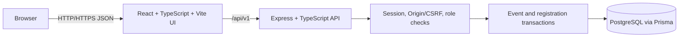

# EventCheck System-Level Software Design Specification

**Project:** EventCheck — Event Registration and Attendance System
**Snapshot:** 2026-11-27
**Current target branch:** origin/sprint-2-staging at 21669b9b902967219724d8a62d29574f3ff0c987
**Verified implementation/test SHA:** `107c93eafbc5c2afb29527336665a6d38269c478`
**Release status:** Sprint 1 has an accepted candidate; Sprint 2 is implemented, tested and staging-integrated, but a formal release acceptance/deployment record is not present.

## 1. Purpose, scope, and status conventions

This SDS describes the integrated Sprint 2 baseline plus the checkpoint F-08 API slice on `feature/f08-registration-attendance-summary`. It uses actual technology, route, model, and migration names from the repository. It distinguishes accepted requirements and contracts from implemented behavior and executed evidence. The F-08 API is implemented and locally verified in this branch but is not yet peer-reviewed, merged, or release-accepted.

| Scope | Current status |
| --- | --- |
| F-01 to F-04 | Accepted Sprint 1 increment; regression was included in Issue 15. The accepted candidate is `da3fa630be862955c973cc9e0c8cddcc5e1dcd6e`. |
| F-05 to F-07 | Accepted contracts; implementation is integrated in `sprint-2-staging`; Issue 15 reports their AC verification passing on `107c93e`. Issue 17 still owns release-candidate verification and acceptance. |
| F-08 | The existing Organizer panel remains client-derived. A separate owner-scoped `/summary` API and aggregate calculator are implemented on the F-08 branch at `25664f8` and pass unit/PostgreSQL tests. Contract v0.4 and D-10/BR-18 remain unreviewed/unaccepted; the UI does not consume the API. |

The SRS is authoritative for behavior, rules, IDs, and sprint allocation. The Feature Inventory gives implementation/test/acceptance status; the Traceability Matrix maps requirements to evidence. Feature contracts define accepted APIs, ACs, and STSs. Issue 15 contains the actual Sprint 2 execution record. See [Deliverable 2 evidence map](deliverable-2-evidence-map.md) for the PDF navigation plan.

## 2. Architecture overview

EventCheck is a single-repository, three-layer web application. The current production-oriented Docker build packages the React frontend and Express API in one application image; Express can serve the built Vite UI when `SERVE_CLIENT=true`. PostgreSQL is the system of record and Prisma provides schema/client and migration management.

| Layer | Actual components | Responsibility |
| --- | --- | --- |
| Presentation | `client/src/App.tsx`, React, TypeScript, Vite | Public discovery; Participant and Organizer workflows; request state and accessible feedback. The client does not grant authorization. |
| Application/API | `server/src/app.ts`, `auth.ts`, `events.ts`, `security.ts`; Express/Node.js/TypeScript | Validate inputs, derive identity, enforce role/ownership, perform transaction-backed state changes, and return safe JSON responses. |
| Persistence | PostgreSQL, Prisma models in `server/prisma/schema.prisma`, versioned migrations | Store identity/session, event, registration lifecycle, and attendance data with foreign keys, check/unique constraints, indexes, and transaction locks. |
| Packaging/runtime | Root `Dockerfile`, `docker-compose.yml`, GitHub Actions workflows | Build a unified UI/API image, run local/test database workflows, and gate builds. GCP deployment evidence is historical and does not identify the current Sprint 2 release. |

Core technologies (React/TypeScript/Vite, Express/TypeScript, PostgreSQL/Prisma) were team-confirmed in the existing design history. This SDS records actual repository use; it does not assert a current cloud revision or production readiness.

## 3. Component responsibilities

| Component | Main responsibility | Requirements / feature |
| --- | --- | --- |
| Authentication and identity | Login, database-backed session lookup/expiry/revocation, current identity, logout | FR-01 to FR-05; F-01 |
| Event management | Organizer-owned event creation, validation, public projection, capacity/deadline update | FR-06 to FR-12; F-02/F-05 |
| Registration lifecycle | Self-registration, capacity/deadline validation, cancellation, history, re-registration | FR-13 to FR-18; F-03/F-06 |
| Organizer registration view | Owner-scoped registrations and statuses; source data for the current metrics panel | FR-15; F-04, partial F-08 UI slice |
| Attendance | Owner check-in, duplicate prevention, event/participant-scoped retrieval | FR-19 to FR-21; F-07 |
| Summary UI | Client-derived active/cancelled/checked-in/not-checked-in/remaining/total counts | Partial F-08 only; no dedicated summary API or rate calculation is implemented |
| Shared security and error handling | Session, Origin validation, role/ownership predicates, safe errors | FR-05; BR-01 to BR-04; NFR-01 to NFR-03/NFR-06 |

## 4. API design and current routes

The API is JSON under `/api/v1`. Successful responses use a `{ data: ... }` envelope; errors use `{ error: { code, message, details? } }`. Dates are emitted as ISO strings. Client-supplied participant or owner identities do not grant authority; the server derives them from the authenticated session.

| Method and path | Access / responsibility | Actual behavior and evidence |
| --- | --- | --- |
| `POST /api/v1/auth/login` | Public | Verify login identifier/password; create server session and set `eventcheck_session` cookie. Invalid credentials return generic 401. |
| `POST /api/v1/auth/logout` | Authenticated | Invalidate current server session, clear cookie, return 204. |
| `GET /api/v1/me` | Authenticated | Return only safe user `id`, `displayName`, and `role`. |
| `GET /api/v1/events` | Public | List published event public projections, including capacity/availability and deadline state. |
| `GET /api/v1/events/:eventId` | Public | Return one published event public projection; omit private owner/registrant data. |
| `POST /api/v1/events` | Organizer | Validate and create an owned Event as `PUBLISHED`; there is no draft state in the current Prisma enum. |
| `GET /api/v1/organizer/events` | Organizer | List the authenticated Organizer's owned events. |
| `GET /api/v1/organizer/events/:eventId` | Owning Organizer | Retrieve owned management details; other owners receive safe not-found. |
| `GET /api/v1/organizer/events/:eventId/registrations` | Owning Organizer | Return event-scoped registration rows and permitted participant fields. |
| `PATCH /api/v1/organizer/events/:eventId` | Owning Organizer | Update `capacity` and/or `registrationDeadline` before event start inside a transaction. |
| `POST /api/v1/events/:eventId/registrations` | Participant | Register the authenticated Participant if published, before effective deadline, non-duplicate, and capacity remains. |
| `GET /api/v1/me/registrations` | Participant | List only the authenticated Participant's registration history. |
| `GET /api/v1/me/registrations/:registrationId` | Owning Participant | Retrieve a single own registration; other participants receive safe not-found. |
| `POST /api/v1/me/registrations/:registrationId/cancel` | Owning Participant | Cancel an eligible own ACTIVE registration before event start; preserve history and `cancelledAt`. |
| `POST /api/v1/organizer/registrations/:registrationId/attendance` | Owning Organizer | Check in an eligible ACTIVE registration for the specified owned Event during `[startAt, endAt)`. |
| `GET /api/v1/organizer/events/:eventId/attendance` | Owning Organizer | Return attendance rows for the owned Event, in stable time/ID order. |
| `GET /api/v1/organizer/events/:eventId/summary` | Owning Organizer | Return capacity, ACTIVE/CANCELLED record counts, remaining seats, ACTIVE checked-in/not-checked-in totals, and attendance rate/null; aggregate-only projection. Implemented as a checkpoint F-08 API slice; acceptance pending. |
| `GET /api/v1/me/registrations/:registrationId/attendance` | Owning Participant | Return own attendance or explicit `attendance: null`. |
| `GET /health` | Public | Liveness response. |
| `GET /api/ready` | Public | Readiness check that executes `SELECT 1` against PostgreSQL and returns 200/503. |

**F-08 endpoint status:** `GET /api/v1/organizer/events/:eventId/summary` is implemented in `server/src/app.ts` as a checkpoint API slice and covered by TEST-F08-01/02/04/05. It requires the authenticated Organizer role, filters Event ID and session Organizer ID in one query, returns aggregate fields only, and uses the standard 401/403/concealed-404/generic-500 envelopes. D-10/BR-18 and the contract remain Proposed/unaccepted. `OrganizerRegistrationsView` still derives its displayed metrics from separate registration and attendance responses; the UI has not been switched to this endpoint.

## 5. Database design and migrations

The physical model is defined in [`server/prisma/schema.prisma`](../server/prisma/schema.prisma). Database enum and model names are preserved below.

| Model | Relevant fields and relationships | Constraints/indexes and purpose |
| --- | --- | --- |
| `User` | `id`, `loginIdentifier`, `displayName`, `role`, `passwordHash`, `createdAt`; relations to sessions, events, registrations, attendances | `loginIdentifier` unique; migration also adds case-insensitive unique lower-case index. Roles are `PARTICIPANT` and `ORGANIZER`. Password hashes only are stored. |
| `Session` | Opaque `id`, `userId`, `createdAt`, `lastActivityAt`, `absoluteExpiry`, `invalidatedAt`; belongs to `User` | Indexes on `userId` and `absoluteExpiry`; user deletion cascades sessions. Auth middleware checks idle/absolute expiry and invalidation. |
| `Event` | `id`, `organizerId`, `title`, `description`, `location`, `startAt`, `endAt`, nullable `registrationDeadline`, positive `capacity`, `publicationState`, `createdAt` | FK to owning User; positive capacity, nonblank required text, `endAt > startAt`; optional deadline check `registrationDeadline <= startAt`; indexes on organizer and `(publicationState,startAt)`. Composite unique `(id, organizerId)` supports Attendance owner consistency. Current `PublicationState` contains only `PUBLISHED`. |
| `Registration` | `id`, `eventId`, `participantId`, `status`, `registeredAt`, nullable `cancelledAt`; optional one-to-one Attendance | Status is `ACTIVE` or `CANCELLED`; check requires ACTIVE with null `cancelledAt` and CANCELLED with non-null `cancelledAt`. Partial unique index `(participantId,eventId) WHERE status='ACTIVE'` preserves cancelled history while preventing two active rows. Lookup indexes cover `(eventId,status)`, `(participantId,status)`, and `(participantId,registeredAt)`. Event/User references restrict deletion to preserve history. |
| `Attendance` | `id`, unique `registrationId`, `eventId`, `participantId`, `recordedByOrganizerId`, `checkedInAt` | One row per registration; composite FK ties it to the same registration/event/participant; composite Event/Organizer FK requires the recording Organizer to own the Event. Indexes on `(eventId,checkedInAt)` and `(participantId,checkedInAt)`; restrictive references retain attendance history. |

Relevant migrations include F-01 authentication/session schema, F-02 event publication constraints, F-03 registration foundation and active-only unique index, registration delete restriction, case-insensitive login uniqueness, F-05 `registrationDeadline` with its start-time check, and F-06 `cancelledAt`/Attendance constraints. They are stored under `server/prisma/migrations/` and applied in order by Prisma.

No summary values are persisted in a separate summary table. The new F-08 API uses one parameterized PostgreSQL statement with scalar count subqueries, so its returned Event capacity and aggregates share one statement snapshot. It reads no Participant records and writes no data. The pre-existing UI still derives displayed counts from separately fetched F-04/F-07 responses and can use mixed-time inputs until it consumes the summary endpoint. The API query has no concurrent-writer experiment yet.

## 6. Authentication, authorization, and security

- `server/src/auth.ts` uses database-backed server sessions. The cookie is named `eventcheck_session`, contains an opaque random 32-byte identifier, is `HttpOnly`, `SameSite=Lax`, and `Secure` when `NODE_ENV=production`.
- Session records enforce the agreed 30-minute idle and 8-hour absolute lifetime. `requireAuth` rejects missing, expired, invalidated sessions and updates activity while the session is valid. Logout marks the row invalid and clears the cookie.
- `csrfGuard` applies before routes and requires the `Origin` of state-changing requests to exactly equal `CLIENT_ORIGIN` (default local origin); otherwise it returns 403 `CSRF_REJECTED`. GET/HEAD/OPTIONS are exempt.
- `requireRole` enforces Participant or Organizer role in the server. Routes/services scope reads and mutations by the session-derived user ID and event ownership. The UI is not the authorization boundary.
- Public event list/detail use a restricted event projection. Registrant identities, session fields, password hashes, and non-owned event details are not public responses.
- Password handling is in `server/src/security.ts`; plaintext credentials and hashes are not returned by APIs. Unexpected server errors return a generic response while diagnostics are server-side.
- No passwords, tokens, database URLs, or production secrets are part of this SDS. Configuration examples use placeholders; deployment secrets are external to tracked application source.

## 7. Business workflows and consistency rules

### 7.1 Event publication and discovery

`POST /api/v1/events` requires Organizer role. Required text, offset-aware start/end instants, end-after-start, and positive integer capacity are validated before a single Event is created as `PUBLISHED`. Current storage has no `DRAFT` state. Public reads filter to `PUBLISHED` and return only approved public fields, capacity/remaining availability, optional deadline, and registration-window state.

### 7.2 Registration and capacity/deadline updates

`createRegistration` in `server/src/app.ts` runs a Prisma transaction and locks the Event row with `SELECT ... FOR UPDATE`. It then verifies existence/publication, checks server time is strictly before `registrationDeadline ?? startAt`, rejects an existing ACTIVE registration, counts ACTIVE rows, enforces `activeCount < capacity`, and inserts an ACTIVE Registration. The database partial unique index is a second guard against duplicate active rows.

The owner PATCH locks the Event row, verifies owner and published state, rejects edits at/after `startAt`, validates deadline ordering, checks a proposed capacity against the active count, and commits changes in one transaction. A capacity reduction below active registrations is rejected; no Participant is displaced. Only ACTIVE registrations consume places; Attendance does not end ACTIVE status.

### 7.3 Cancellation and re-registration

Cancellation verifies the authenticated Participant owns the Registration, then locks Event followed by Registration. It reads Attendance under that transaction, samples server time after acquiring locks, and allows a transition only when the row is ACTIVE, has no Attendance, and current time is strictly before Event start. It stores `status=CANCELLED` and server `cancelledAt`; repeated cancellation returns the original state/time without releasing another place. F-03 registration remains the re-registration route and creates a distinct row only after all current publication/deadline/duplicate/capacity checks pass.

### 7.4 Check-in and attendance retrieval

Check-in also locks Event then Registration. It verifies selected Event, Organizer ownership, ACTIVE status, no prior Attendance, and server time in `[startAt,endAt)`. One Attendance row records the Registration, Event, Participant, owning Organizer, and `checkedInAt`. The unique registration constraint prevents duplicates. F-06 uses the same lock order, so cancellation cannot commit alongside Attendance for the same registration. Attendance never reduces active count or capacity use.

### 7.5 Current summary behavior

The Organizer view currently displays Active registrations, Cancelled registrations, Checked in, Not checked in, Remaining seats, and Total registration records from API-loaded Registration and Attendance rows. Separately, the checkpoint `/summary` API now returns those persisted aggregates plus attendance rate or null for zero active rows. Unit/PostgreSQL tests cover provisional calculations, zero-active API output, authorization, response privacy, and read-only retrieval. UI N/A/loading/error/retry/refresh behavior and a concurrent-writer snapshot experiment remain unimplemented/unverified.

## 8. Request validation and error handling

| Condition | Current response convention |
| --- | --- |
| Malformed JSON | 400 `MALFORMED_JSON` |
| Valid JSON with invalid field/body | 422 validation error with safe code/message and field details where provided |
| Missing/expired/revoked session | 401 `UNAUTHENTICATED` |
| Wrong role or disallowed Origin | 403 `FORBIDDEN` or `CSRF_REJECTED` |
| Missing/non-owned private resource | Safe 404 such as `EVENT_NOT_FOUND` or `REGISTRATION_NOT_FOUND` |
| Duplicate, full, closed, late, or invalid lifecycle conflict | 409 with feature-specific safe codes such as `REGISTRATION_DUPLICATE`, `EVENT_FULL`, `REGISTRATION_CLOSED`, `CANCELLATION_CLOSED`, or `ATTENDANCE_ALREADY_EXISTS` |
| Unexpected persistence/runtime error | Transaction rolls back; generic 500 `INTERNAL_SERVER_ERROR` without raw database detail in the response |

Input is validated at the API boundary and transaction/service layer where state may change. Error paths are expected to preserve previously committed state. Issue 15 includes controlled failure tests and before/after database assertions; details are in the AC matrix.

## 9. Transaction and concurrency design

| Operation | Transaction and lock rule | Evidence boundary |
| --- | --- | --- |
| Registration | Lock Event before checking deadline, duplicate ACTIVE row, active count, and capacity; insert in the same transaction. Partial unique index backs up application checks. | Sprint 1 last-seat/duplicate tests and F-05/F-06 races; Issue 15 records passing results on `107c93e`. |
| Capacity/deadline edit | Lock Event; verify owner/state/time, active count and deadline; update only after all checks. | F-05 `TEST-F05-10/11`; lock evidence describes at least one observed PostgreSQL blocker and final committed invariants. |
| Cancellation | Lock Event then Registration, check Attendance and start boundary, update lifecycle atomically. | F-06 `TEST-F06-11/13/14` and F-07 shared race tests. |
| Check-in | Lock Event then Registration, validate eligibility/window and insert Attendance atomically; unique constraint prevents second row. | F-07 `TEST-F07-05/09/10`. |
| F-08 summary API | One parameterized PostgreSQL SELECT supplies Event capacity and all aggregate counts from one statement snapshot; no writes or locks. | TEST-F08-02/05 pass in isolated PostgreSQL; a coordinated concurrent-writer experiment, UI integration, and independent review remain open. The displayed UI still uses separate reads. |

The lock tests do not overclaim what PostgreSQL observed: the Issue 15 supplemental F-06 test saw at least one backend blocked by the test holder while all launched HTTP promises remained pending. It does not establish that every request transaction was waiting in PostgreSQL.

## 10. Deployment and operational architecture

The repository has a unified Docker packaging path, local Compose database support, environment-based configuration, `/health` liveness and `/api/ready` database readiness endpoints, GitHub Actions quality checks, and a separate release workflow. The repository's deployment documentation and release workflow target one Cloud Run application image, Cloud SQL PostgreSQL, Artifact Registry, Secret Manager, and Workload Identity Federation.

The available GCP release evidence is historical: Lab 5 documents Cloud Run service `eventcheck`, revision `eventcheck-00006-mqn`, release commit `945a59c`, PR #41, and Actions run `44999977201`. The Lab 5 document explicitly says the revision may not be current. Issue 15 reports CI run [45869394130](https://github.com/Ttime52/EventCheck/actions/runs/45869394130) passed its CI checks on corrected commit `fda1a77`; it is not a deployment record. No Sprint 2 candidate Cloud Run revision, image digest, or production smoke result is recorded in the inspected repository.

Issue 17 must identify the exact release candidate and record fresh CI/regression outcome, commit, deployed image digest/revision if deployment is performed, health/readiness/login smoke result, and persisted-data/restart evidence. If any step is not performed, retain it as an explicit gap.

## 11. Requirement traceability and open decisions

This SDS preserves the SRS IDs and maps architectural areas as follows:

| Architecture area | Requirements and responsibilities |
| --- | --- |
| Authentication, session and protected access | FR-01 to FR-05; BR-04; NFR-01 to NFR-03; F-01; SR-01/SR-05 |
| Event creation, public projection, ownership | FR-06 to FR-12; BR-01/02/05/12; F-02/F-03; SR-01/SR-02 |
| Capacity, registration, cancellation, history | FR-10/13/14/16/17/18; BR-05 to BR-15; NFR-04 to NFR-06; F-03/F-05/F-06; SR-02 |
| Check-in and attendance retrieval | FR-15/19/20/21; BR-02/03/04/11/16/17; F-04/F-07; SR-01/SR-02/SR-03 |
| Summary UI and planned reporting | FR-22/23; BR-18; F-08; SR-01/SR-02. Current UI is partial; D-10/BR-18 policy remains proposed. |
| Accessibility, maintainability, testing, deployment, performance | NFR-07 to NFR-12; SR-03 to SR-06; all features as applicable |

Open or pending decisions/evidence:

- D-10 and BR-18 F-08 summary definitions remain proposed. Contract v0.4 and an API/unit/PostgreSQL test slice exist; independent review, policy acceptance, remaining UI/lifecycle/concurrency work, and release integration remain pending.
- D-12's numeric performance and viewport targets remain proposed; no quantitative NFR-07 run is recorded.
- The current enum has no unpublished Event state; Sprint 1 records this as an accepted limitation, so unpublished-state negative behavior is not demonstrated by this schema.
- Current Sprint 2 release acceptance and GCP deployment status are not established by passing tests, a staging merge, or historical Lab 5 deployment.
- Sprint 1 UAT template results remain NOT RUN; Lab 6/7 findings were not found in inspected refs. See the [continuity and change register](sprints/sprint-2/continuity-and-change-register.md).

## 12. References

- [Software Requirements Specification](srs.md)
- [Feature Inventory](features.md)
- [Requirements Traceability Matrix](traceability.md)
- [Sprint Plan](sprints/plan.md)
- [Sprint 2 AC Verification](sprints/sprint-2/ac-verification.md)
- [Issue 15 Integration Verification](sprints/sprint-2/integration-verification.md)
- [Lab 5 Deployment Evidence](labs/lab-05/deployment.md)
