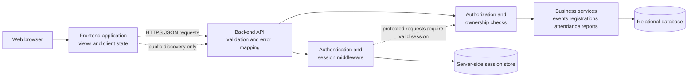
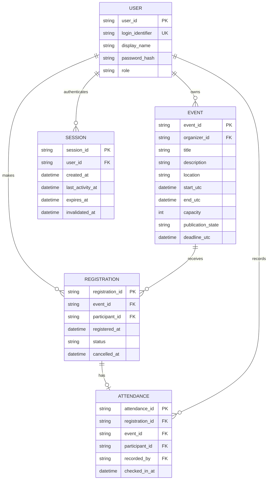
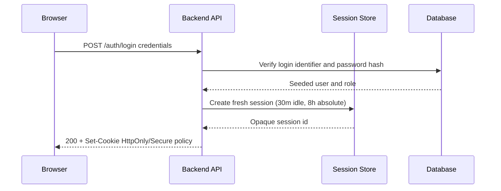
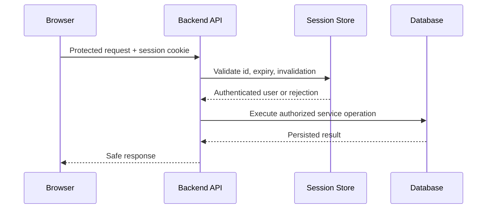
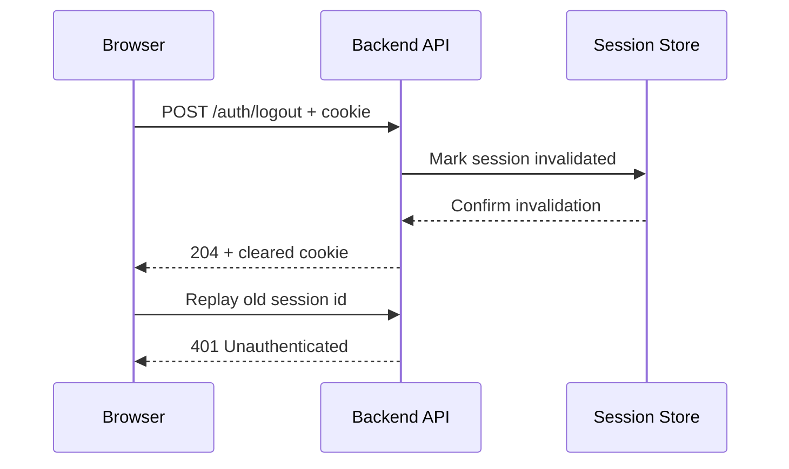
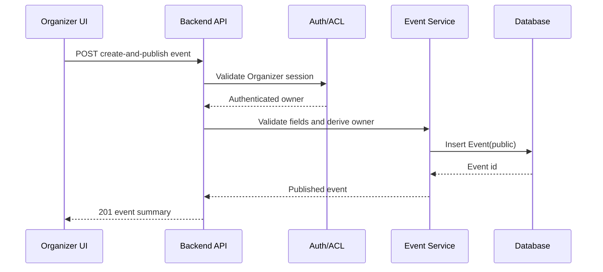
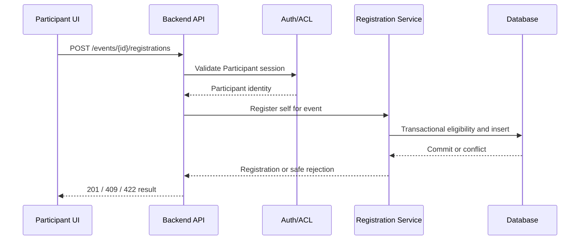
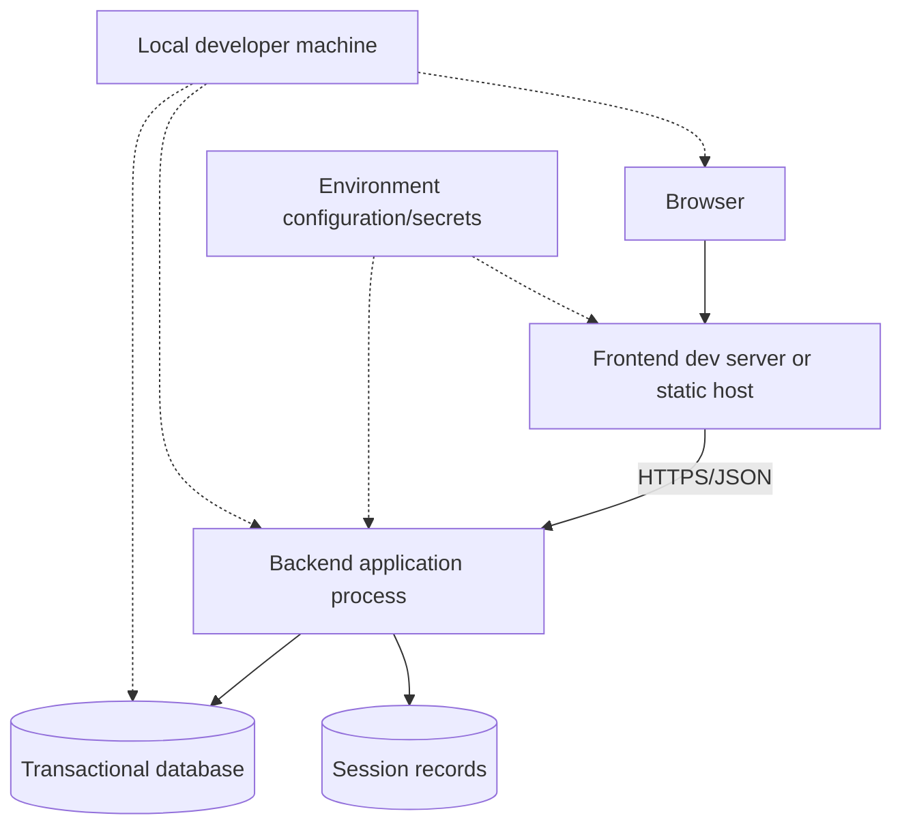

# EventCheck System-Level Software Design Specification

**Course:** CPE 334 — Introduction to Software Engineering in the Age of AI Agents

**Theme:** 3 — Event Registration and Attendance System

**Issue:** #3 — System Architecture and System-Level SDS

**Status:** Proposed design for peer review; this document is not an implementation report.

## 1. Introduction

### 1.1 Purpose and scope

This System-Level Software Design Specification (SDS) translates the approved EventCheck requirements into an implementable architecture for a two-student team. It covers the complete product across Sprints 1–3 and provides enough detail to implement the Sprint 1 vertical slice: authentication, event publication, public discovery, participant registration, personal retrieval, and owner registration management.

The SDS describes logical components, responsibilities, data ownership, interfaces, security, transactions, deployment readiness, and verification seams. It does not claim that the application, tests, deployment, or performance measurements already exist. Exact acceptance criteria and test specifications remain the responsibility of the feature contracts.

### 1.2 Relationship and audience

The [SRS](srs.md) is authoritative for observable behavior, business rules, quality targets, IDs, and sprint allocation. The [Feature Inventory](features.md) groups those requirements into F-01–F-08 and SR-01–SR-06. The [Traceability Matrix](traceability.md) records coverage and open evidence gaps. The [Sprint Plan](sprints/plan.md) governs sequencing and completion gates. This SDS fills the architecture, data, API, permission, session, and deployment design gap identified by G-06.

The audience is the two student developers, peer reviewers, instructor/TA, and acceptance testers. Decisions marked **Approved** are carried forward from the SRS. Choices marked **Proposed** are recommendations that require team review before being treated as implementation commitments. Open questions remain open; no implementation or stakeholder approval is inferred.

## 2. Architectural Overview

EventCheck uses a conventional three-layer web application with one deployable backend and one frontend application. Logical services are modules inside the backend, not separate microservices. This keeps the system understandable and testable for two students while preserving clear boundaries.



The Presentation Layer renders public and authenticated views, sends requests, displays explicit loading/empty/error/success states, and never decides authorization. The Application/API Layer validates input, resolves the authenticated identity, applies role and ownership policy, executes business transactions, and returns safe status/error responses. The Persistence Layer stores users, sessions, events, registrations, and attendance with database constraints and indexes.

Public `GET` discovery/detail requests may be unauthenticated under approved Q-08. Registration, identity, event management, organizer lists, attendance, and reports require a server-validated session. Every protected request repeats authorization in the backend even when the UI hides a control.

## 3. Technology Stack and Design Rationale

The repository currently contains documentation only and no committed framework or runtime choice. The following stack is therefore **Proposed**, not approved. The design remains portable to an equivalent implementation.

| Area | Proposed technology or boundary | Responsibility and rationale | Status and constraints |
| --- | --- | --- | --- |
| Frontend | Small TypeScript web application using a conventional component framework (for example React) | Accessible views, routing, form state, API client, and explicit states. A familiar framework limits custom DOM code. | Proposed. Must not hold authorization state as trusted data. |
| Backend | TypeScript runtime with a lightweight HTTP framework (for example Node.js + Express/Fastify) | Routes, middleware, validation, services, transaction boundaries, and safe error mapping. | Proposed. Keep one backend deployment and a testable service layer. |
| API | JSON over HTTPS with resource-oriented REST-like routes | Simple browser-to-backend contract suitable for Sprint 1 and later feature contracts. | Proposed. Route names below are design candidates, not completed APIs. |
| Database | PostgreSQL or an equivalent transactional relational database | Foreign keys, unique constraints, transactions, row locks/conditional updates, and durable state directly support BR-08–BR-11 and NFR-05. | Proposed. The selected engine must support the stated transaction guarantees. |
| Data access | Parameterized SQL or a thin ORM/query builder | Centralizes queries and transaction handling without hiding locking behavior. | Proposed. No frontend or in-memory substitute may be the system of record. |
| Sessions | Server-side session records and opaque cookie identifier | Matches approved D-02/Q-09 and supports logout invalidation and server-side expiry checks. | Approved design; cookie attributes remain deployment-configured. |
| Testing | Unit/service tests plus API/integration tests against a real database; selected UI/e2e checks | Verifies authorization, persistence, constraints, and races at the boundary where they occur. | Method required by the Sprint Plan; test framework is Proposed. |
| Deployment | Local frontend/backend/database first; Docker/CI/CD/GCP at Lab 5 | Keeps Sprint 1 reproducible while preserving a path to later operational delivery. | Local readiness is Sprint 1; cloud delivery is not claimed. |

## 4. Component Design

Logical components are modules in the frontend, backend, or persistence layer. They do not imply separately deployed services.

| Component | Purpose, inputs, outputs, and dependencies | Requirements | Sprint |
| --- | --- | --- | --- |
| Public Event Discovery | Requests published events/details; receives public fields, capacity, remaining places, and availability. Depends on Event Service. | FR-11, FR-12, BR-04, F-03 | 1 |
| Login/Logout and Current Identity | Submits credentials; receives a safe identity or generic failure; starts, reads, and invalidates sessions. | FR-01–FR-05, NFR-02, NFR-03, F-01 | 1 |
| Organizer Event Management | Validates and submits create-and-publish data; displays owned records. Owner is derived server-side. | FR-06–FR-10, BR-12, D-03, D-04, D-08, F-02 | 1/2 |
| Participant Registration | Submits self-registration and retrieves only the current participant's records. | FR-13–FR-18, BR-06–BR-15, F-03, F-05, F-06 | 1/2 |
| Organizer Registration List | Requests registrations for one owned event; backend filters by ownership and returns only event-scoped fields. | FR-15, BR-02, BR-03, BR-04, F-04 | 1 |
| Check-in and Attendance Views | Future owner-operated check-in and authorized attendance retrieval. | FR-19–FR-21, BR-16, BR-17, F-07 | 2 |
| Reporting Views | Future event-level registration/attendance summaries from committed state. | FR-22, FR-23, BR-18, F-08 | 3 |
| Authentication/Session Module | Credential verification, session creation/lookup/expiry, cookie handling, logout invalidation, CSRF protection. | FR-01–FR-05, NFR-02, NFR-03, SR-05 | 1 |
| Authorization Module | Role checks, ownership predicates, server-derived identity, and safe denials for event and registration operations. | FR-05, BR-01–BR-04, NFR-01, SR-01 | 1 |
| Event Service | Event validation, publication, public projection, owner management, time/capacity rules. | FR-06–FR-12, BR-01–BR-05, BR-12, BR-14, BR-15, SR-01 | 1/2 |
| Registration Service | Eligibility, duplicate/capacity checks, transaction-safe insert/cancel/re-register, and durable persistence. | FR-13–FR-18, BR-06–BR-15, NFR-04–NFR-06, SR-02 | 1/2 |
| Attendance Service | Eligibility, exactly-once check-in, attendance retrieval and privacy. | FR-19–FR-21, BR-16, BR-17, SR-01, SR-02 | 2 |
| Reporting Service | Access-controlled, consistent committed aggregates and zero-denominator behavior. | FR-22, FR-23, BR-18, SR-01, SR-02 | 3 |
| Validation/Error Module | Shared field validation, typed error categories, safe messages, and rollback/no-partial-state handling for rejected or failed writes. | FR-07, FR-16, FR-20, NFR-06 | 1–3 |

## 5. Data Design

The logical model uses stable identifiers and UTC instants for storage/comparison. User-facing date/time input and display are labelled Asia/Bangkok initially, as approved by D-08/Q-11. Database constraints, not only forms, enforce integrity.



### 5.1 Entities and integrity

- **User:** `user_id` is stable; `login_identifier` is unique; passwords are salted hashes; `role` is Participant or Organizer for seeded accounts. Self-service account administration is outside scope.
- **Event:** every row has exactly one Organizer owner. `capacity` is a positive integer. `end_utc` is after `start_utc`. Publication state distinguishes unpublished/private from published/public. `deadline_utc` is nullable until Sprint 2 and cannot exceed start time when present.
- **Registration:** each row belongs to one Event and Participant. An active registration consumes one place; attendance never releases capacity. A database uniqueness strategy permits at most one active row per participant/event (for example a partial unique index, or a transactionally enforced current-state table) while retaining cancelled history from Sprint 2.
- **Attendance:** one row is associated with one registration; a unique constraint on `registration_id` prevents duplicate check-in. The service derives Event and Participant from the referenced Registration rather than trusting duplicate request fields, verifies that the authenticated recording user owns that Event, and inserts Attendance in one transaction. Foreign keys provide existence guarantees; transactional consistency and ownership checks provide the cross-entity guarantees that ordinary foreign keys alone cannot provide.
- **Session:** the cookie carries only an opaque identifier. The server stores user association, creation/activity/expiry times, and invalidation state. Lookup rejects expired or invalidated records.

Recommended indexes are unique `login_identifier`, `Event(organizer_id)`, `Event(publication_state, start_utc)`, `Registration(event_id, status)`, `Registration(participant_id, status)`, unique active participant/event, `Attendance(registration_id)`, and `Session(session_id)`.

Persistence boundaries are transaction boundaries: event publication commits its validated Event; registration commits the registration and any capacity guard together; cancellation commits lifecycle state and place release together; check-in commits exactly one Attendance. Failed operations roll back all writes. A naive read-count-then-insert sequence is unsafe because two requests can observe the same free place; the concurrency design in Section 9 is mandatory.

## 6. Authentication and Session Design

The following is the approved D-02/Q-09 design: server-side sessions, HttpOnly cookies, Secure cookies in HTTPS environments, 30-minute idle timeout, 8-hour absolute lifetime, server-side validation, and invalidation on logout. SameSite and CORS values are deployment-dependent but must preserve production CSRF protection and must not weaken cookie security.

### 6.1 Login and session lifecycle

1. The browser submits credentials over HTTPS to the login endpoint.
2. The backend verifies the seeded account's password hash and role without revealing account-existence details.
3. The backend creates a fresh, unpredictable session identifier, stores the user association and timestamps, and sends an HttpOnly cookie (`Secure` when HTTPS; appropriate SameSite policy).
4. Each protected request loads the session server-side, rejects missing/expired/revoked sessions, refreshes activity only within the absolute lifetime, and derives the current user from the record.
5. Logout invalidates the session server-side and clears the cookie. Replaying its old identifier fails.

Session identifiers are generated by a cryptographically secure facility, are never placed in URLs or logs, and are rotated on login to prevent fixation. Passwords are never stored or returned in plaintext. State-changing browser requests use same-site protections plus a CSRF token or equivalent origin validation appropriate to the selected framework. CORS is explicit, narrow, and credential-aware; wildcard origins are not used with credentials.







## 7. Authorization and Access Control

Unauthenticated Visitor is an access state, not an application role. Identity is always derived from the validated session; client-provided `owner_id` or `participant_id` is ignored or rejected.

| Operation | Visitor | Participant | Owning Organizer | Non-owning Organizer |
| --- | --- | --- | --- | --- |
| List/view published events | Allow public fields | Allow | Allow | Allow |
| Create new Event | Deny | Deny | Allow; owner is assigned from the authenticated session | Allow; owner is assigned from the authenticated session |
| Publish or manage existing Event | Deny | Deny | Allow only for own event | Deny for another Organizer's event |
| Retrieve owned event management details | Deny | Deny | Allow own records | Deny |
| Register for event | Deny | Allow self, if eligible | Deny | Deny |
| View own registrations | Deny | Allow own records | Deny unless Participant | Deny unless Participant |
| View event registration list | Deny | Deny | Allow own event | Deny |
| Cancel own registration (Sprint 2) | Deny | Allow own active record | Deny unless Participant | Deny unless Participant |
| Change owned capacity/deadline (Sprint 2) | Deny | Deny | Allow own event | Deny |
| Record/retrieve attendance (Sprint 2) | Deny | Retrieve own | Record/retrieve own event | Deny |
| View owned reports (Sprint 3) | Deny | Deny | Allow own event | Deny |

Role middleware checks the required role, then ownership predicates check `event.organizer_id = session.user_id` or `registration.participant_id = session.user_id`. Authorization occurs before protected data is returned. Denials use safe 401/403/404-style responses that do not reveal whether another user's private record exists. Direct API calls receive the same checks as UI actions.

## 8. Key System Workflows

### A. Organizer creates and publishes

The Organizer logs in, submits required fields, and the backend validates nonblank text, date ordering, positive capacity, and Sprint 1 field policy. The owner is derived from the session; the client cannot assign it. The Event is persisted and published atomically. A subsequent public query returns only the public projection.



### B. Public discovery

The visitor requests published events. The Event Service applies the publication predicate and returns public fields, capacity, remaining places, and availability. Registrant identities, unpublished rows, and private management data never enter this projection.

### C. Participant registration

The backend validates a Participant session, published Event, duplicate-active constraint, and capacity inside one transaction. It returns a persisted registration or a typed conflict; the UI display is advisory and is rechecked server-side.



### D. Personal and owner retrieval

Personal retrieval filters by the authenticated Participant, not a URL-supplied participant identity. Owner retrieval first proves ownership of the selected Event and then returns only that Event's registrations. Both are persisted reads and survive restart.

### E. Future workflows

Sprint 2 adds deadline checks, controlled capacity edits, cancellation/re-registration history, and the **Proposed BR-16 check-in policy**: only the owning Organizer may check in an existing active registration for that event, during the server-authoritative time window `[event.start, event.end)`. This remains pending team review, as recorded in Q-05. Sprint 3 adds committed-state summaries. Each extension reuses the same authorization, UTC comparison, transaction, and safe-error boundaries; it does not move later features into Sprint 1.

## 9. Concurrency and Transaction Design

Registration correctness is a database invariant, not a UI feature. For a registration transaction, the service locks the Event row (or uses an equivalent atomic conditional update), checks publication and active count, checks the participant/event active uniqueness constraint, inserts only if both checks pass, and commits. A constraint violation or capacity conflict rolls back and returns a safe conflict. The implementation must use the selected database's documented transaction isolation/locking behavior; an in-memory mutex alone is insufficient across processes or instances.

**Scenario 1 — last available place:** with capacity 1, requests from Participants A and B serialize on the Event row or compete in one atomic guarded update. One transaction inserts and commits; the other observes no remaining place or a failed guard and rolls back. The committed active count remains 1.

**Scenario 2 — duplicate requests:** two requests from the same Participant serialize and/or hit the active participant/event unique constraint. At most one active Registration commits; the other rolls back as duplicate.

```mermaid
sequenceDiagram
    participant A as Participant A
    participant B as Participant B
    participant R as Registration Service
    participant DB as Database
    par Concurrent requests
        A->>R: Register Event(capacity=1)
        B->>R: Register Event(capacity=1)
    end
    R->>DB: Tx A lock/guard Event, check count, insert
    R->>DB: Tx B waits, then recheck count
    DB-->>R: Tx A commits one active registration
    DB-->>R: Tx B rolls back full/conflict
    R-->>A: Success
    R-->>B: Conflict; refresh availability
```

Capacity edits in Sprint 2 use the same Event-row guard and require the new capacity to be at least the committed active count. Repeated/concurrent cancellation uses an idempotent state predicate so one transition releases a place and repeats do not release another. Check-in uses a unique registration constraint. All failures leave the prior committed state intact. These controls implement BR-08, BR-09, BR-10, BR-11 and NFR-05.

## 10. API and Interface Design

The following endpoint inventory is **Proposed** until feature contracts approve exact routes and representations. All protected routes require a valid server-side session and backend authorization.

| Method/path | Requester and auth | Responsibility and typical outcomes | Requirements | Sprint |
| --- | --- | --- | --- | --- |
| `POST /auth/login` | Any visitor | Verify credentials; set session cookie. `200`, generic `401`, validation `422`. | FR-01, FR-02, NFR-02 | 1 |
| `POST /auth/logout` | Authenticated user | Invalidate session and clear cookie. `204`, `401`. | FR-03, Q-09 | 1 |
| `GET /me` | Authenticated user | Return id/display name/role only. `200`, `401`. | FR-04, FR-05 | 1 |
| `GET /events` and `GET /events/{id}` | Public or authenticated | Return published public projection. `200`, empty list, safe not-found. | FR-11, FR-12, Q-08 | 1 |
| `POST /events` | Organizer | Validate, derive owner, optionally create-and-publish. `201`, `401/403`, `422`. | FR-06–FR-08, BR-12 | 1 |
| `GET /organizer/events` | Organizer | Return only owned management records. `200`, `401/403`. | FR-09 | 1 |
| `POST /events/{id}/registrations` | Participant | Transaction-safe self-registration. `201`, duplicate/full conflict, `401/403/404/422`. | FR-13, FR-16, BR-06–BR-11 | 1 |
| `GET /me/registrations` | Participant | Return only own persisted registrations. `200`, `401`. | FR-14 | 1 |
| `GET /me/registrations/{id}` | Participant | Open one persisted registration only when its `participant_id` matches the server-derived identity. `200`, safe `403/404`, `401`. | FR-14, BR-03, BR-04 | 1 |
| `GET /organizer/events/{id}/registrations` | Owning Organizer | Return registrations for owned Event only. `200`, safe `403/404`. | FR-15 | 1 |
| `PATCH /organizer/events/{id}` | Owning Organizer | Sprint 2 capacity/deadline transaction. `200`, conflict/validation. | FR-10, BR-14, BR-15 | 2 |
| `POST /me/registrations/{id}/cancel` | Registration Participant | Sprint 2 cancellation with retained history. | FR-17, FR-18, BR-13 | 2 |
| `POST /organizer/registrations/{id}/attendance` | Owning Organizer | Sprint 2 exactly-once check-in. | FR-19, FR-20 | 2 |
| `GET /organizer/events/{id}/attendance` and `/summary` | Owning Organizer | Sprint 2 attendance; Sprint 3 summaries. | FR-21–FR-23, BR-18 | 2/3 |
| `GET /me/registrations/{id}/attendance` | Participant | Sprint 2 returns attendance associated with the server-derived Participant's own registration only. | FR-21, BR-03, BR-04 | 2 |

Request/response schemas, AC IDs, and STS IDs belong in feature contracts. No route above is evidence of a completed API.

## 11. Error Handling and Validation

The backend distinguishes authentication failures (missing/invalid credentials or session, generally 401), authorization failures (wrong role/owner, 403 or safe not-found), validation errors (malformed fields, 422), business conflicts (duplicate/full/closed/concurrent state, 409), and unexpected persistence failures (generic 500 with server-side diagnostic logging). Messages are actionable for the authorized caller but do not reveal passwords, session identifiers, participant lists, or existence of unrelated private records.

Validation occurs at the API boundary and again in the service/transaction where state can change. Invalid login does not create a session. Missing/expired sessions do not reach protected services. Invalid Event fields, unpublished/missing Events, duplicate/full registrations, invalid deadlines/cancellations/check-ins, and database conflicts leave no partial committed state. Database failures are rolled back, logged without secrets, and returned as a safe retry-oriented failure. Sprint 2 time-window behavior uses server-authoritative UTC instants.

## 12. Non-Functional Design

| NFR | Architectural response and verification boundary |
| --- | --- |
| NFR-01 Security/privacy | Backend RBAC/ownership, public projection, safe errors, password hashing, session protections, CSRF/CORS policy, and no identifier trust. Verify anonymous, wrong-role, cross-user, and cross-owner requests. |
| NFR-02 Authentication | Approved server-side sessions with HttpOnly cookies and Secure in HTTPS environments. Verify valid/invalid login and cookie behavior. |
| NFR-03 Session lifetime | Store activity/absolute expiry server-side (30-minute idle, 8-hour absolute), reject expired/revoked records, invalidate logout. Verify boundary tests with controlled time. |
| NFR-04 Committed-data preservation | Durable transactional database writes and restart-safe retrieval preserve accepted Event, Registration, and later Attendance/Cancellation records. Verify real-database restart/retrieval, then repeat with durable deployment storage at Lab 5. |
| NFR-05 Concurrency | Database transaction/locking/atomic guard plus active uniqueness constraint; inspect committed database state in Sprint 1 race tests. |
| NFR-06 Safe failed-write recovery | Validation, authorization, transaction rollback, and controlled failure handling leave relevant state unchanged and never return false success. Verify negative cases and injected persistence failures with before/after database inspection. |
| NFR-07 Performance | SR-06 defines Sprint 1 response-time targets and method; quantitative sequential/concurrent measurement against the real API/database belongs in Sprint 3. No benchmark result is claimed here. |
| NFR-08 Accessible workflow state and errors | Semantic controls, keyboard access, visible focus, readable validation, labelled Asia/Bangkok times, and explicit loading/empty/error/success states. Verify the planned viewport/keyboard walkthrough and selected UI/e2e checks. |
| NFR-09 Maintainable versioned contracts | Layered modules, migration discipline, stable requirement/feature IDs, contract and traceability links, teammate review, and regression links support maintainable change. Verify sampled engineering history and linked documents. |
| NFR-10 Reproducible automated verification | Documented clean build/test commands, real database assertions, selected end-to-end journeys, retained counts/commit/failures, and no silently skipped required checks. Verify against the release. |
| NFR-11 Repeatable deployment | Sprint 1 local setup/build/test/seed/restart is documented and reproducible; Docker, CI/CD, GCP, durable restart, and gated release checks belong to Lab 5. |
| NFR-12 Externalized configuration and secret protection | Environment variables and safe examples configure runtime; real secrets stay out of tracked files, bundles, evidence, and routine logs; missing required configuration fails safely. Verify configuration review, secret scan, artifact inspection, and missing-variable startup. |

## 13. Deployment and Runtime Architecture



Sprint 1 targets a reproducible local frontend, backend, and real database with seeded synthetic accounts. Connection strings, cookie/security mode, and secrets come from environment configuration or a local secret mechanism and are never committed. The session store may be a database table in the first implementation; it remains server-side and durable across application restart.

Lab 5 is the checkpoint for Docker, CI/CD, and GCP/durable deployment. Later sprints reuse the same logical boundaries for regression and release hardening. No cloud deployment, CI result, or production readiness is claimed by this document.

## 14. Design Decisions and Trade-offs

| Decision | Alternatives | Rationale and trade-off | Status/source |
| --- | --- | --- | --- |
| Three-layer web architecture | Microservices, serverless-only | Small team gains simple local execution and clear tests; a single deployment gives less independent scaling. | Proposed; architecture baseline |
| Server-side sessions | JWT/localStorage tokens | Approved design supports revocation, idle/absolute expiry, and HttpOnly cookies; requires session persistence and lookup. | Approved; D-02, Q-09 |
| Relational transactional model | Document store, in-memory state | Foreign keys, uniqueness, and transactions directly enforce registration invariants; schema migrations require care. | Proposed; BR-08–BR-11 |
| Backend authorization | UI-only checks, client role flags | Central enforcement protects direct API use and ownership; adds middleware/service checks. | Required; FR-05, BR-04/05 |
| Database-safe registration writes | Read-count then insert, in-memory mutex | Works across concurrent requests/instances and preserves committed invariants; requires database-specific transaction tests. | Required; NFR-05 |
| Public discovery | Login-gated discovery | Approved Q-08 improves discovery while keeping registration/private data protected; public projections must be narrow. | Approved; Q-08 |
| UTC storage, Asia/Bangkok display/input | Local-time storage | Avoids comparison ambiguity and matches approved initial user context; conversion/labels must be tested. | Approved; D-08, Q-11 |
| Combined Create & Publish | Mandatory draft workflow | Meets Sprint 1 with fewer states while retaining validation; draft UI may be added only if later approved. | Approved baseline; D-04 |
| Later lifecycle modules | Sprint 1 implementation of all features | Keeps two-person scope feasible and preserves the proposed Sprint 2/3 allocation; shared schema must anticipate migrations. | Proposed team planning decision; D-13 |

Exact frontend/backend/database framework, API route names, CSRF library, session-store implementation, and deployment topology remain Proposed until the team records a technology decision. They must not be represented as completed implementation.

## 15. Requirements and Feature Traceability

The SDS uses the existing IDs without introducing new requirements. Coverage is summarized below; the full row-level mapping remains in [traceability.md](traceability.md).

| Architectural area | Requirement and feature references |
| --- | --- |
| Authentication, sessions, identity | FR-01–FR-05; NFR-01–NFR-03; D-02; Q-09; F-01; SR-05 |
| Event ownership, validation, publication, discovery | FR-06–FR-12; BR-01–BR-05, BR-12; D-03, D-04, D-08; Q-08, Q-11; F-02, F-03; SR-01, SR-02 |
| Registration, duplicate/capacity integrity | FR-13–FR-18; BR-06–BR-15; NFR-04, NFR-05; F-03–F-06; SR-01–SR-03 |
| Attendance and reporting extensions | FR-19–FR-23; BR-16–BR-18; F-07, F-08; SR-01–SR-04 |
| Quality, testability, deployment, maintainability | NFR-06–NFR-12; SR-05, SR-06; all F-01–F-08 integration |

All baseline IDs are preserved: FR-01–FR-23, BR-01–BR-18, NFR-01–NFR-12, D-01–D-13, Q-01–Q-11, F-01–F-08, and SR-01–SR-06. This SDS does not alter sprint allocations or statuses.

## 16. Risks, Assumptions, and Open Design Questions

| Item | Treatment/status |
| --- | --- |
| Overbooking or duplicate registration under concurrency | High risk; mitigated by transaction/constraint design and real database race tests in Sprint 1. |
| Role/ownership mistakes | High risk; mitigated by server-derived identity, centralized predicates, and cross-owner tests. |
| Cookie/SameSite/CORS deployment mismatch | Open deployment risk; select and verify environment-specific configuration without weakening production security. |
| Session persistence and expiry boundary defects | Mitigated by server-side timestamps, controlled-clock tests, restart checks, and logout replay tests. |
| Sprint 2 schema evolution | Medium risk; use migrations and preserve cancelled history, attendance uniqueness, and active-count invariants. |
| Two-student workload | Feasible only with the planned vertical slice, shared review, and no unapproved scope expansion. |
| Exact framework, ORM, API naming, CSRF library, and deployment provider | Open technical decisions; this SDS proposes constraints and responsibilities but does not claim approval. |
| Sprint 2 policy questions Q-01–Q-06/Q-10 and Sprint 3 summary policy D-10/BR-18 | Remain governed by the SRS and sprint gates; do not silently resolve them in implementation. |

Assumptions are limited to seeded synthetic accounts, a transactional database, HTTPS in deployed environments, and the approved public discovery/session/time decisions. If a technology or policy conflicts with the SRS, the conflict must be reported and reviewed rather than silently changing another document.

## 17. References

- [EventCheck Software Requirements Specification](srs.md)
- [EventCheck Feature Inventory](features.md)
- [EventCheck Requirements Traceability Matrix](traceability.md)
- [EventCheck Three-Sprint Plan](sprints/plan.md)
- `group_work_specs_v1.pdf`, Theme 3 and Section 6 (course reference, if available locally)
- `project_deliverable_1_v1.pdf`, Part C system-level design guidance (course reference, if available locally)

The SDS records planned design only. It does not claim implementation, test execution, deployment, GitHub-rendered diagram verification, stakeholder interviews, or approval of unresolved technical choices.
